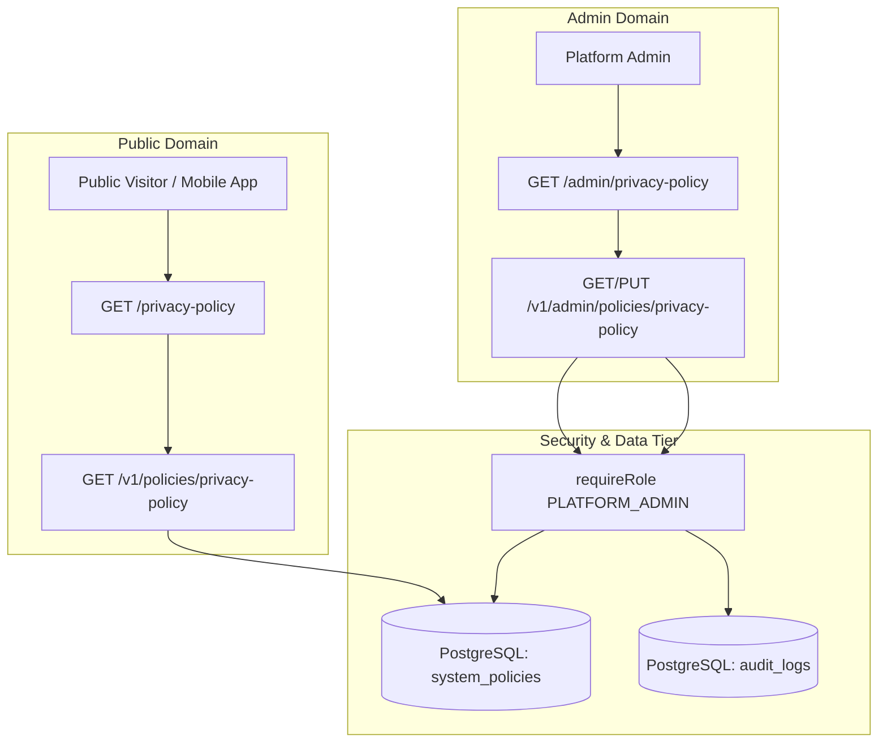

# Feature Specification: Platform Admin-Managed Privacy Policy

**Document ID**: FEAT-ADMIN-04  
**Version**: 1.0.0  
**Status**: Implemented (Authoritative Implementation Specification; Production Launch Subject to Institutional Legal Review)  
**Authority Level**: Authoritative Implementation Specification  
**Document Type**: Specification & Implementation RFC  
**Owner**: Platform Engineering & Security  
**Supersedes**: 0.3.3-draft  
**Last Reviewed**: 2026-10-29  
**Related ADR**: [ADR-031: Admin-Managed Privacy Policy Architecture](../../engineering/adrs/adr-031-admin-managed-privacy-policy.md)  

---

## 1. Purpose & Problem Statement

The NST Events privacy policy is currently a 140-line hard-coded, static JSX file located at [`apps/dashboard/app/(public)/privacy-policy/page.tsx`](file:///Users/sohamdhande/Docs_Local/nst-events/apps/dashboard/app/(public)/privacy-policy/page.tsx). Any compliance update, contact modification, or legal revision requires editing source code, executing a full Docker container build (`ghcr.io/nst-sdc/nst-dashboard`), and performing a Kubernetes rollout.

Furthermore, the Next.js dashboard runs with two stateless replicas (`replicas: 2`) in the NST Kubernetes cluster without persistent volumes. Storing policies on the container filesystem (`fs.writeFile`) is architecturally invalid as it causes split-brain state between replicas and loses all modifications upon pod termination or rollout.

This specification establishes the canonical architecture, data model, API contracts, security controls, and UI workflows for a **Platform Admin-managed Privacy Policy** that supports live Markdown editing, split-screen preview, draft persistence, atomic publishing, public rendering, and full audit logging without requiring application redeployment.

---

## 2. Architectural Boundaries & Implementation Authorization

> [!NOTE]
> ### SCOPED IMPLEMENTATION AUTHORIZATION NOTICE
> Per project directives:
> 1. Implementation was authorized under an explicit, minimum scoped exception to the architecture freeze for FEAT-ADMIN-04.
> 2. The database schema in `packages/database`, API route module in `apps/api`, and Route Handler in `apps/dashboard` have been implemented and verified with automated test suites.
> 3. Production rollout remains strictly subject to institutional legal review by General Counsel on legal commitments and data retention terms. No unauthorized claims of General Counsel approval are made.
> 4. The broader architecture freeze on unrelated modules and schemas remains fully active.

---

## 3. Domain Boundaries & Separation of Concerns



* **System Policies vs. Event Forms**: Unlike `EventForm` (which models per-event questionnaires) or `EventResult` (which models competition scorecards), `SystemPolicy` models system-wide legal, governance, and institutional policies.
* **Draft vs. Published Isolation**: An active draft MUST NOT be accessible to public visitors, ordinary students, or search engine crawlers. Only the `published_content` field is projected to unauthenticated endpoints.
* **Global Role Isolation**: Editing and publishing system policies is restricted exclusively to `PLATFORM_ADMIN`. Neither `FACULTY_ADMIN`, `FACULTY_MENTOR`, nor `CLUB_ADMIN` possess authority to alter university-wide privacy terms.

---

## 4. Proposed Persistence Model & Schema Architecture

### 4.1 Proposed Prisma Schema Design (`packages/database`)
*(Proposed schema design pending governance approval and validation during implementation)*

In Prisma ORM, relations between models require reciprocal declarations on both participating models. The proposed design requires:

#### 1. In `model User` ([`packages/database/prisma/schema.prisma`](file:///Users/sohamdhande/Docs_Local/nst-events/packages/database/prisma/schema.prisma#L11-L76))
Add the proposed reciprocal relation array:
```prisma
model User {
  // ... existing verified fields ...
  publishedPolicies SystemPolicy[] @relation("PolicyPublisher")
}
```

#### 2. In `model SystemPolicy` (Proposed Model)
```prisma
/// System-wide governance and legal policies (Privacy Policy, Terms of Service).
model SystemPolicy {
  slug                String    @id @db.VarChar(64)
  title               String    @db.VarChar(128)
  publishedContent    String    @map("published_content") @db.Text
  draftContent        String    @map("draft_content") @db.Text
  concurrencyRevision Int       @default(1) @map("concurrency_revision")
  publishedVersion    Int       @default(1) @map("published_version")
  publishedAt         DateTime? @map("published_at") @db.Timestamptz(6)
  publishedById       String?   @map("published_by_id") @db.Uuid
  updatedAt           DateTime  @default(now()) @updatedAt @map("updated_at") @db.Timestamptz(6)

  publishedBy         User?     @relation("PolicyPublisher", fields: [publishedById], references: [id], onDelete: SetNull)

  @@map("system_policies")
}
```

> [!NOTE]
> **Prisma Validation Status & Audit Separation**:
> This reciprocal relation and `SystemPolicy` model definition represent a proposed schema design. While syntax and relation conventions were verified against Prisma compiler rules on an isolated disposable scratch copy outside the repository (`The schema ... is valid 🚀`), the production schema in `packages/database/prisma/schema.prisma` remains strictly **frozen and unvalidated**.
> 
> Neither the schema addition, database migration, API handlers, nor frontend routes have been implemented or validated in the production codebase. Formal compilation, migration generation, and runtime verification will occur exclusively during the approved implementation phase after explicit unfreezing authorization is granted.

### 4.2 Publisher Deletion, Technical Availability & Legal Review Requirements
* **Physical Deletion (`onDelete: SetNull`)**:
  * In PostgreSQL, `onDelete: SetNull` is a relational foreign key action that applies **strictly to physical SQL row deletion** (`DELETE FROM users WHERE id = ...`). If an administrator user row is physically purged from the database, PostgreSQL triggers this constraint and sets `system_policies.published_by_id = NULL`.
* **Soft Deletion (`deleted_at DateTime?`)**:
  * In NST Events, user accounts are not physically dropped; they are soft-deleted by setting `users.deleted_at = NOW()` (as defined in `packages/database/prisma/schema.prisma:L35`).
  * Soft deletion is an application-level convention and does **NOT** trigger foreign key cascading or `SetNull` actions in PostgreSQL. Consequently, soft-deleting an administrator leaves `published_by_id` pointing to the user's UUID.
* **Independent Technical Policy Availability**:
  * The policy content (`published_content`), version number (`published_version`), and timestamp (`published_at`) reside as independent scalar columns on `system_policies`.
  * The public API endpoint (`GET /v1/policies/:slug`) queries `system_policies` directly without joining `users`.
  * Public policy serving to students, website visitors, and mobile apps is **100% decoupled from the publisher user record**. Regardless of whether the publisher user is active, soft-deleted, deactivated, or physically dropped, technical content availability is completely unaffected.
* **Historical Publisher Attribution**:
  * To maintain historical attribution under soft or physical deletion, the publisher's identity is recorded in the `audit_logs` table (`actor_id`, `newState.publisher_name`, `newState.publisher_email`). Even if the publisher's user record is subsequently altered, soft-deleted, or physically removed, the historical audit trail retains the recorded author identity.
* **Mandatory Institutional Legal Review**:
  * Technical persistence, foreign-key nullification, and audit attribution provide a technical record of policy changes, but **do not determine or guarantee legal validity**.
  * The university's Office of the General Counsel / Institutional Legal Review must evaluate and approve policy wording, publication procedures, and historical retention to determine legal validity and statutory compliance under applicable laws (e.g., India's Digital Personal Data Protection Act, 2023).

### 4.3 Initial Migration & Seeding Execution
* **Migration Name**: `20261101000000_add_system_policies`
* **Baseline Policy Record**: The migration SQL MUST insert an initial baseline record for `privacy-policy` using the verified text currently hard-coded in `apps/dashboard/app/(public)/privacy-policy/page.tsx`:
  * `slug`: `'privacy-policy'`
  * `title`: `'Privacy Policy — NST Events'`
  * `published_content`: Markdown equivalent of the hard-coded JSX sections.
  * `draft_content`: Same baseline content.
  * `concurrency_revision`: `1`
  * `published_version`: `1`
  * `published_at`: `'2026-09-09T00:00:00Z'` (preserving historical effective date).
  * `published_by_id`: `NULL` (initial system baseline).
* **Verified `AuditLog` Schema Facts & Migration Execution Distinction**:
  - `id`: Managed by PostgreSQL `BIGSERIAL` sequence (`BigInt` in Prisma).
  - `actor_id`: Nullable PostgreSQL `UUID` referencing `users(id) ON DELETE SET NULL`.
  - `entity_id`: Nullable PostgreSQL `UUID`. Because `'privacy-policy'` is a text slug, `entity_id` MUST be stored as `NULL` for system policies, with `slug` captured inside `new_state->>'slug'`.
  - **Migration RLS Distinction**: Application writes in `apps/api` run as role `nst_app` inside `withUserContext(adminId, ...)`, setting `app.user_id = adminId` and satisfying the `Allow INSERT on audit_logs` RLS check (`actor_id = current_user_id()`). However, whether the migration seed satisfies `Allow INSERT on audit_logs` depends on the database connection role executing migrations (e.g., `postgres` vs. `nst_app`), whether `FORCE ROW LEVEL SECURITY` is enabled on `audit_logs`, and whether `current_user_id()` is NULL. Migration RLS compliance must be formally confirmed against the actual migration execution context during implementation.

---

## 5. Dual Versioning & Optimistic Concurrency Control

To ensure data integrity and prevent lost updates, this specification explicitly decouples **Internal Concurrency Control** from **Public Legal Versioning**:

| Version Attribute | Database Field | Increment Trigger | Publicly Exposed? | Purpose |
|---|---|---|---|---|
| **Concurrency Revision** | `concurrency_revision` | Increments on **EVERY** write operation (`SAVE_DRAFT` and `PUBLISH`). | **No** (Admin API only) | Protects against concurrent lost updates via atomic conditional SQL queries. |
| **Published Version** | `published_version` | Increments **ONLY** on explicit `PUBLISH` action. | **Yes** (Public API & Header) | Represents authoritative legal revision number (e.g., Version 1, Version 2, Version 3). |

### 5.1 Atomic Conditional Update & Conflict Detection
When saving a draft or publishing, the client submits `base_concurrency_revision: number`. The backend executes an atomic conditional update:

```sql
UPDATE system_policies
SET draft_content = $new_content,
    published_content = CASE WHEN $action = 'PUBLISH' THEN $new_content ELSE published_content END,
    published_version = CASE WHEN $action = 'PUBLISH' THEN published_version + 1 ELSE published_version END,
    published_at = CASE WHEN $action = 'PUBLISH' THEN NOW() ELSE published_at END,
    published_by_id = CASE WHEN $action = 'PUBLISH' THEN $actor_id ELSE published_by_id END,
    concurrency_revision = concurrency_revision + 1,
    updated_at = NOW()
WHERE slug = $slug AND concurrency_revision = $base_concurrency_revision
RETURNING concurrency_revision, published_version, published_at;
```

### 5.2 HTTP 409 Conflict Handling (Zero Data Loss)
If zero rows are returned (indicating another administrator updated the policy concurrently):
1. The backend responds with `409 Conflict`:
   ```json
   {
     "error": "CONCURRENT_POLICY_MODIFICATION",
     "message": "Policy was modified by another administrator. Your local edits have been preserved.",
     "current_concurrency_revision": 7,
     "current_published_version": 2,
     "server_draft_content": "# Privacy Policy\n\n...",
     "last_modified_by": {
       "name": "Jane Doe",
       "email": "jane@nstsdc.org"
     }
   }
   ```
2. **Client-Side Non-Destructive Protection**:
   * The editor **MUST NOT** overwrite or discard the administrator's local text.
   * A side-by-side reconciliation modal opens displaying:
     * *Left Column*: "Your Local Edits (Unsaved)".
     * *Right Column*: "Current Server Version (Modified by Jane Doe)".
   * The administrator has three explicit choices:
     * **Review & Merge**: Keeps local edits in the editor with server differences highlighted for manual merging.
     * **Overwrite Server**: Re-submits using `base_concurrency_revision = 7` to intentionally overwrite the remote draft.
     * **Discard Local Edits**: Explicitly resets the local editor to the server's current draft.

---

## 6. Publication, Multi-Tier Caching & Qualified Staleness Analysis

### 6.1 Publication Behavior
* When an administrator clicks **"Publish Policy"**, the client submits the **current editor content** in the payload (`content: string`, `action: 'PUBLISH'`, `base_concurrency_revision: number`).
* The publication transaction is strictly atomic:
  1. Validates that `base_concurrency_revision === policy.concurrency_revision`.
  2. Updates `published_content = content`.
  3. Synchronizes `draft_content = content` (so the working draft matches the newly published baseline, preventing phantom uncommitted diffs).
  4. Increments `published_version = published_version + 1`.
  5. Increments `concurrency_revision = concurrency_revision + 1`.
  6. Sets `published_at = NOW()`, `published_by_id = req.user.id`, `updated_at = NOW()`.
  7. Emits an append-only `audit_logs` record containing the full legal snapshot.
  8. Triggers internal cache invalidation webhook.

### 6.2 Multi-Tier Caching Architecture & Qualified Staleness Analysis
To avoid contradictory staleness claims, all caching tiers must be modeled explicitly against verified repository configurations:

```
┌────────────────────────────────────────────────────────────────────────┐
│ Layer 4: Client Browser (Cache-Control: max-age=60)                    │
│   • Caches response locally for up to 60 seconds if honored.           │
│   • Navigations within 60s serve from memory/disk without network.     │
└───────────────────────────────────┬────────────────────────────────────┘
                                    │
┌───────────────────────────────────▼────────────────────────────────────┐
│ Layer 3: Reverse Proxy / K8s Ingress (Traefik / Optional Edge CDN)      │
│   • Traefik ingress routes to nst-dashboard-service (port 80).         │
│   • Verified config: No Traefik caching middleware in manifests.       │
│   • Caching at this layer depends on optional edge CDN or plugins.     │
└───────────────────────────────────┬────────────────────────────────────┘
                                    │
┌───────────────────────────────────▼────────────────────────────────────┐
│ Layer 2: Next.js Server Cache (Data Cache / Tag Revalidation)          │
│   • Verified deployment: 2 stateless replicas (replicas: 2).           │
│   • Independent per-pod in-memory caches (no shared Redis cache).      │
│   • ClusterIP webhook reaches only 1 pod; second pod misses purge.     │
└───────────────────────────────────┬────────────────────────────────────┘
                                    │
┌───────────────────────────────────▼────────────────────────────────────┐
│ Layer 1: Express Backend Origin (PostgreSQL)                           │
│   • Authoritative persistence in system_policies.                     │
│   • Emits Cache-Control: public, max-age=60, s-maxage=60, SWR=60.      │
│   • Emits persisted publication timestamp: published_at / updated_at.  │
└────────────────────────────────────────────────────────────────────────┘
```

#### Reconciled Cache-Control Header
The backend serves `GET /v1/policies/:slug` with:
```http
Cache-Control: public, max-age=60, s-maxage=60, stale-while-revalidate=60
x-nst-origin-timestamp: 2026-10-29T00:35:00.000Z
```

#### Uncoordinated Multi-Pod Caching & Compounding Staleness Analysis
1. **Confirmed Deployment Architecture**:
   - The dashboard deployment runs 2 stateless replicas (`infrastructure/kubernetes/dashboard-deployment.yaml:9`) with `output: 'standalone'` and no shared Next.js cache handler.
   - Upon publication, `apps/api` calls `POST http://nst-dashboard-service/api/revalidate?tag=policy-privacy-policy`. Standard kube-proxy round-robin routes this request to **only one pod**.
   - Pod A purges its cache; **Pod B does NOT receive the invalidation signal** and continues serving cached content until its 60-second TTL expires.
2. **Conditional Staleness Scenario (Not a Guaranteed Bound)**:
   - *Architectural Target*: ~120 seconds under direct origin fetch or single-cache hit.
   - *Conditional Compounding Scenario (180–240 seconds)*:
     Staleness can compound to 180–240 seconds **only if the following explicit conditions hold**:
     1. Downstream caching (an edge CDN or caching reverse proxy) is deployed and configured to honor `s-maxage=60` and `stale-while-revalidate=60` (note: current `ingress.yaml` has no Traefik caching middleware enabled).
     2. A request reaches un-invalidated Pod B just before its 60s TTL expires ($t \approx 59\text{s}$), causing the downstream proxy to recache the stale response for a fresh 60s window (+ up to 60s SWR).
     3. A browser client fetches from the downstream proxy at $t \approx 118\text{s}$ and caches locally for 60s (`max-age=60`).
   - Because downstream proxy and browser behaviors depend on deployment configurations and client implementations not fully verifiable from repository manifests, the 180–240-second window is an engineering scenario estimate, not a guaranteed upper bound.

#### Trustworthy Origin-Timestamp Metadata Propagation
* Standard HTTP `Age` headers do not survive Next.js SSR rendering and reflect proxy residence rather than legal policy freshness.
* **Strict Timestamp Source Requirement**:
  - The timestamp displayed in the Stale Warning Banner MUST originate strictly from **persisted policy/publication metadata in PostgreSQL (`SystemPolicy.published_at` or `updated_at`)**, NOT from the time at which potentially stale HTML was rendered by Next.js.
  - Next.js SSR embeds this persisted publication timestamp directly into the HTML markup (`<div id="privacy-policy-root" data-origin-timestamp="2026-10-29T00:35:00.000Z">`).
  - The client UI calculates true elapsed data age directly from `data-origin-timestamp` (`Date.now() - persistedPublicationTimestamp`), ensuring accurate stale warning banners regardless of intermediate proxy header modifications.

---

## 7. Public Page Unavailable vs. Stale Content Semantics

> [!IMPORTANT]
> ### PROHIBITION OF SILENT STATIC FALLBACK
> The system **MUST NOT** silently render outdated, hard-coded fallback text when the API is down, as doing so falsely presents expired terms as currently effective law.

The public page strictly differentiates an HTTP 503 unavailable response from a successful response serving explicitly identified stale content:

### 7.1 Cold Failure: Server-Side HTTP 503 Mechanism (Resolving Next.js Route Conflict)
When `GET /v1/policies/:slug` fails (database connection failure, network timeout, or HTTP 500) and **no valid cached representation exists**:

#### The Next.js Route Architecture Challenge
- The public route currently uses `app/(public)/privacy-policy/page.tsx`.
- **Next.js App Router Restriction**: In Next.js, `page.tsx` and `route.ts` CANNOT coexist within the same route directory (`app/(public)/privacy-policy/`). Defining both generates a fatal build error: `Conflicting app/ routes: page and route cannot both be defined`.
- **The Caching Hazard of Standard Error Components**: Rendering a fallback `<UnavailableNotice />` component inside `page.tsx` causes Next.js to return **HTTP status 200 OK** by default. Intermediate reverse proxies and browsers will treat this HTTP 200 as a valid page and cache the outage screen, causing an extended false outage even after the backend recovers.

#### Selected & Implemented Architecture: Option 1 (Route Handler Replacement)

To avoid route collisions (`page.tsx` and `route.ts` cannot coexist at the same route segment) and ensure true wire-level status control, the implementation replaces `page.tsx` with `app/(public)/privacy-policy/route.ts`:
- **Implementation**: `app/(public)/privacy-policy/route.ts` executes a server-side `fetch` to `apps/api` (`/v1/policies/privacy-policy`) with a 5000ms timeout.
- **Wire-Level HTTP 503 on Failure**: On upstream fetch failure (timeout, network error, HTTP 500, or invalid payload), the Route Handler returns a wire-level `503 Service Unavailable` with `Cache-Control: no-store, no-cache, must-revalidate, max-age=0` and renders an accessible brutalist HTML notice containing zero unverified fallback text.
- **Cache-Enabled HTTP 200 on Success**: On successful fetch, safe Markdown rendering converts Markdown to sanitized HTML, returning HTTP 200 with `Cache-Control: public, max-age=60, s-maxage=60, stale-while-revalidate=60`.
- **Zero Middleware Overhead**: Eliminates unnecessary duplicate network probes and latency on unrelated routes.

#### Implementation & Wire-Level Test Verification
- **Status**: Implemented and verified via automated test suites.
- **Wire-Level Verification**: Verified via `apps/dashboard/tests/public-privacy-policy-resilience.test.ts`:
  1. Wire-level response status is strictly `503 Service Unavailable` when upstream API is down.
  2. Response header `Cache-Control` strictly contains `no-store, no-cache, must-revalidate, max-age=0`.
  3. Response body contains the honest brutalist notice and **ZERO** bundled static policy text.
  4. Response returns status `200` with Markdown rendered to sanitized HTML when upstream succeeds.
- **Brutalist Error UI**:
  ```
  ╔════════════════════════════════════════════════════════════════════╗
  ║  CAMPUS LEGAL REPOSITORY // SERVICE NOTICE                        ║
  ║  LEGAL DOCUMENT TEMPORARILY UNAVAILABLE                            ║
  ║                                                                    ║
  ║  We are currently unable to verify the authoritative, legally     ║
  ║  binding NST Events privacy policy from the institutional record.  ║
  ║  To protect student data rights, unverified fallback content is    ║
  ║  not displayed.                                                    ║
  ║                                                                    ║
  ║  [ RETRY CONNECTION ↻ ]          Support: support@nstsdc.com       ║
  ╚════════════════════════════════════════════════════════════════════╝
  ```
- Includes a functional `RETRY CONNECTION ↻` button that triggers a client-side refetch without full page reload.

### 7.2 Stale Content Delivery: HTTP 200 with Stale Warning Banner
When the origin backend is unreachable or slow, but a previously valid representation is available in the reverse proxy / Next.js cache (within the SWR window or served via cache-fallback):
* The response status is **HTTP 200 OK** (delivering the cached Markdown text).
* The client UI inspects the embedded `data-origin-timestamp` attribute:
  * Calculates elapsed age: `cacheAgeSeconds = Math.floor((Date.now() - new Date(originTimestamp).getTime()) / 1000)`.
* If `cacheAgeSeconds > 60` or the live backend reconnection probe fails:
  * The UI renders the policy Markdown, but **MUST render an explicit, high-contrast warning banner** permanently docked at the top of the viewport:
    ```
    ⚠️ CAUTION // VIEWING CACHED POLICY ARCHIVE
    Cached on: 2026-10-28 14:22:10 UTC (Cache Age: 3 minutes, 15 seconds ago).
    The live legal repository is temporarily unreachable. This archived text
    may not reflect real-time amendments. Active reconnection in progress...
    ```
  * **Clear Distinction**: The banner explicitly communicates:
    1. The exact timestamp when the policy was captured from origin.
    2. The exact computed cache age (in minutes and seconds).
    3. That this text is an archived cached snapshot and may not reflect the active published terms.
  * As soon as background revalidation succeeds or connection to the origin recovers, the banner is automatically dismissed and replaced with the verified live version.

---

## 8. Complete Publication History & Audit Logging Specification

### 8.1 Representation of Initial Seed in History
To ensure continuous auditability from day one, the initial migration `20261101000000_add_system_policies` MUST insert a baseline record into `audit_logs`:
* `id`: Autoincrement BigInt (managed by PostgreSQL `BIGSERIAL` sequence).
* `actor_id`: `NULL` (indicating initial automated system bootstrap; nullable in schema).
* `action`: `'POLICY_INITIAL_SEED'`.
* `entity_type`: `'SystemPolicy'`.
* `entity_id`: `NULL` (due to PostgreSQL UUID type constraint on `entity_id`).
* `previous_state`: `NULL`.
* `new_state`:
  ```json
  {
    "slug": "privacy-policy",
    "title": "Privacy Policy — NST Events",
    "published_version": 1,
    "concurrency_revision": 1,
    "published_at": "2026-09-09T00:00:00Z",
    "publisher_name": "System Initial Seed",
    "publisher_email": "system@nstsdc.org",
    "content_sha256": "4f8a91b...e3b",
    "content": "# Privacy Policy — NST Events\n\n**Effective date:** September 9, 2026..."
  }
  ```

### 8.2 Subsequent Publication & Complete History Reconstruction
Every subsequent publication event MUST preserve sufficient information to reconstruct the exact legal Markdown text, author, and timestamp:

* **Dual Snapshot Storage in `audit_logs`**:
  Every publication (`action: 'POLICY_PUBLISHED'`) stores:
  * `actor_id`: UUID of the publishing Platform Admin.
  * `entity_type`: `'SystemPolicy'`.
  * `entity_id`: `NULL` (slug tracked inside JSON payload).
  * `previous_state`: Full JSON snapshot of the prior published version:
    - `slug`: `'privacy-policy'`.
    - `published_version`: Prior version integer (e.g., `1`).
    - `published_at`: Prior publication timestamp.
    - `publisher_id`, `publisher_name`, `publisher_email`: Prior publisher metadata.
    - `content`: Complete Markdown text of the prior version.
  * `new_state`: Full JSON snapshot of the newly published version:
    - `slug`: `'privacy-policy'`.
    - `published_version`: New version integer (e.g., `2`).
    - `published_at`: New publication timestamp (`NOW()`).
    - `publisher_id`, `publisher_name`, `publisher_email`: New publisher metadata.
    - `content`: Complete Markdown text of the new version.
* **Storage Model Rationale**:
  Rather than maintaining a separate `system_policy_versions` table or using event-sourcing diff deltas:
  1. Storing complete `previous_state` and `new_state` snapshots directly in `audit_logs` provides **self-contained point-in-time reconstruction** of any version $V$ without scanning adjacent rows.
  2. It enables instant bidirectional visual diffing directly from a single audit record.
  3. It allows one-click rollback in the Admin Ops console by reading `previous_state.content`.
* **Full Text Reconstruction Query**:
  Any historical published version $V$ can be reconstructed with 100% fidelity using:
  ```sql
  SELECT new_state->>'content' AS markdown_text,
         new_state->>'publisher_name' AS publisher_name,
         new_state->>'publisher_email' AS publisher_email,
         created_at AS published_at
  FROM audit_logs
  WHERE entity_type = 'SystemPolicy'
    AND new_state->>'slug' = 'privacy-policy'
    AND action IN ('POLICY_INITIAL_SEED', 'POLICY_PUBLISHED')
    AND (new_state->>'published_version')::int = $version;
  ```

### 8.3 Scenario-Based Storage Growth Estimates
Storage projections represent scenario-based estimates, NOT an absolute schema-enforced bound, because publication and draft-save counts are not constrained by database schema limits:

#### Scenario Parameters & Input Assumptions
- **Content Size**: API Zod schema limits `Buffer.byteLength(content, 'utf8') <= 100 * 1024` (102,400 bytes = 100 KiB). Note: JavaScript's `.length` counts UTF-16 code units; UTF-8 byte validation is enforced authoritatively on the backend.
- **`POLICY_PUBLISHED`**: Dual snapshot stores both `previous_state` and `new_state` content plus metadata.
- **`POLICY_SAVED_DRAFT`**: Metadata and SHA-256 hash only (< 500 bytes).
- **Disk Usage Factors**: Actual disk usage is affected by PostgreSQL TOAST compression (LZ4/PGLZ compressing text/JSONB over 2 KB by ~40–60%), B-Tree index overhead on `actor_id` and `created_at` (~10–15%), Heap tuple headers (24 bytes/row), WAL logs, database backup retention, and multi-byte UTF-8 Unicode characters (2–4 bytes per non-ASCII character).

#### Growth Scenarios

| Scenario | Input Assumptions | Publications Storage | Draft Saves Storage | Net Estimated Growth |
|---|---|---|---|---|
| **Scenario A: Standard Production** | • 15 KiB typical policy<br>• 4 publications/year<br>• 500 draft saves/year | $4 \times (15\text{ KiB} \times 2 + 2\text{ KiB}) = 128\text{ KiB/yr}$ | $500 \times 0.5\text{ KiB} = 250\text{ KiB/yr}$ | **~378 KiB/year**<br>(~1.89 MiB in 5 yrs) |
| **Scenario B: Active Legal Iteration** | • 30 KiB expanded policy<br>• 12 publications/year<br>• 1,000 draft saves/year | $12 \times (30\text{ KiB} \times 2 + 2\text{ KiB}) = 744\text{ KiB/yr}$ | $1,000 \times 0.5\text{ KiB} = 500\text{ KiB/yr}$ | **~1.24 MiB/year**<br>(~6.2 MiB in 5 yrs) |
| **Scenario C: Max Payload Stress Test** | • 100 KiB max content<br>• 12 publications/year<br>• 2,000 draft saves/year | $12 \times (100\text{ KiB} \times 2 + 5\text{ KiB}) \approx 2.46\text{ MiB/yr}$ (uncompressed) | $2,000 \times 0.5\text{ KiB} = 1.0\text{ MiB/yr}$ | **~3.46 MiB/year**<br>(~17.3 MiB in 5 yrs) |

*Conclusion*: Across all modeled scenarios, annual storage growth remains modest (< 5 MB/year even under maximum content payload stress), confirming that dual-snapshot auditing does not threaten database scalability.

### 8.4 Audit Immutability Status & Access Control Reality
* **Existing Infrastructure Audit (Verified in Migration `20260808102105_phase12_audit_logs_rls`)**:
  Row Level Security (RLS) is enabled on `audit_logs` with a single policy:
  `CREATE POLICY "Allow SELECT on audit_logs" ON audit_logs FOR SELECT USING (...);`
  There are NO `INSERT`, `UPDATE`, or `DELETE` policies for standard application users. Writes in `apps/api` are executed via elevated backend database sessions (`tx.auditLog.create`).
* **Existing vs. Proposed Controls**:
  * **Existing Controls**: Application-level users connecting under RLS cannot modify, delete, or directly insert into `audit_logs`.
  * **Proposed Application-Tier Invariant**: Backend service modules treat `audit_logs` as strictly append-only; no update or delete routes or service methods exist.
  * **Honest Limitation Against Privileged Operators**: Audit records are **not** cryptographically immutable or hardware WORM-enforced. PostgreSQL superusers, database administrators, and connections with `BYPASSRLS` privileges can alter or delete rows via raw SQL.
  * Immutability of publication history is explicitly categorized as an **application-tier architectural control and design convention**, not a hardware or cryptographically guaranteed protection.

---

## 9. Proposed API Contracts & Canonical Documentation Alignment

Until ADR-031 is formally approved, the following additions are cataloged for documentation alignment:

### 9.1 Planned Addition to `docs/api/02-api-routing-matrix.md`
*(To be added under `## Proposed / Deferred API (RFC FEAT-ADMIN-04)` upon unfreezing)*

| Method | Mount Prefix | Router | Local Path | Final Path | Auth | Authorization | Service | Response |
|---|---|---|---|---|---|---|---|---|
| GET | `/v1` | `policiesRouter` | `/policies/:slug` | `/v1/policies/:slug` | None | Public | `policiesService.getPublishedPolicy` | 200 |
| GET | `/v1/admin` | `adminPoliciesRouter` | `/policies/:slug` | `/v1/admin/policies/:slug` | Required | `PLATFORM_ADMIN` | `adminPoliciesService.getPolicy` | 200 |
| PUT | `/v1/admin` | `adminPoliciesRouter` | `/policies/:slug` | `/v1/admin/policies/:slug` | Required | `PLATFORM_ADMIN` | `adminPoliciesService.updatePolicy` | 200 |

### 9.2 Planned Addition to `docs/frontend/shared/DATA_CONTRACT.md`
*(To be added under `## [PROPOSED] System Policy Contracts`)*

#### `GET /v1/policies/:slug` (Public)
* **Response (200 OK)**:
  ```json
  {
    "slug": "privacy-policy",
    "title": "Privacy Policy — NST Events",
    "content": "# Privacy Policy — NST Events\n\n**Effective date:** September 9, 2026...",
    "published_version": 2,
    "published_at": "2026-10-29T00:35:00.000Z"
  }
  ```

#### `GET /v1/admin/policies/:slug` (Admin)
* **Response (200 OK)**:
  ```json
  {
    "slug": "privacy-policy",
    "title": "Privacy Policy — NST Events",
    "published_content": "# Privacy Policy — NST Events...",
    "draft_content": "# Privacy Policy — NST Events\n\n## 1. Updated Clause...",
    "concurrency_revision": 6,
    "published_version": 2,
    "published_at": "2026-10-29T00:35:00.000Z",
    "updated_at": "2026-10-29T01:10:00.000Z",
    "published_by": {
      "id": "e4b2d180-2a54-4f88-9213-9d10e6cb8114",
      "full_name": "Platform Administrator",
      "email": "admin@nstsdc.org"
    }
  }
  ```

#### `PUT /v1/admin/policies/:slug` (Admin)
* **Request Body**:
  ```json
  {
    "title": "Privacy Policy — NST Events",
    "content": "# Privacy Policy — NST Events...",
    "action": "SAVE_DRAFT",
    "base_concurrency_revision": 6
  }
  ```
* **Success Response (200 OK)**:
  ```json
  {
    "status": "SUCCESS",
    "slug": "privacy-policy",
    "action": "SAVE_DRAFT",
    "concurrency_revision": 7,
    "published_version": 2,
    "updated_at": "2026-10-29T01:15:00.000Z"
  }
  ```
* **Conflict Response (409 Conflict)**:
  ```json
  {
    "error": "CONCURRENT_POLICY_MODIFICATION",
    "message": "Policy was modified by another administrator. Your local edits have been preserved.",
    "current_concurrency_revision": 8,
    "current_published_version": 2,
    "server_draft_content": "...",
    "last_modified_by": { "name": "Jane Doe", "email": "jane@nstsdc.org" }
  }
  ```

---

## 10. Markdown Security & Safe URL Architecture

### 10.1 Defense-in-Depth Rendering
Reuses the production-tested in-house [`MarkdownRenderer`](file:///Users/sohamdhande/Docs_Local/nst-events/apps/dashboard/components/projects/MarkdownRenderer.tsx):
1. **Zero Raw HTML Execution**: Emits pure React Virtual DOM elements (`React.createElement` / JSX). Raw HTML elements (`<script>`, `<iframe onload="...">`, `<svg onerror="...">`) are treated as plain text strings and safely escaped by React. No `dangerouslySetInnerHTML` is used anywhere.
2. **Safe Protocol Filtering**:
   URLs parsed from markdown links `[text](url)` and images `` pass through [`sanitizeUrl()`](file:///Users/sohamdhande/Docs_Local/nst-events/apps/dashboard/components/projects/MarkdownRenderer.tsx#L15-L28):
   * **Allowed Schemes**: `https://`, `http://`, `mailto:`, relative paths `/`, anchor links `#`.
   * **Blocked Schemes**: `javascript:`, `data:`, `vbscript:`, `blob:`, `file:`.
   * **Blocked Presentation**: Unsafe links render as non-clickable struck-through text (`<span className="line-through decoration-rose-500/50">...</span>`), preventing click-jacking and DOM XSS.
3. **Payload Size Guard**:
   API-level Zod validation enforces `Buffer.byteLength(content, 'utf8') <= 100 * 1024` (102,400 bytes = 100 KiB) to protect against memory exhaustion. Express `body-parser` JSON limit is configured with a route-scoped `256kb` parser for `/v1/admin/policies` in `apps/api/src/app.ts` (accommodating Markdown text plus JSON encoding overhead), while strictly maintaining the default 100kb limit across all unrelated endpoints.

---

## 11. Mobile Application Compatibility

* **Existing Mobile URL**:
  [`apps/mobile/src/infrastructure/config.ts:L43`](file:///Users/sohamdhande/Docs_Local/nst-events/apps/mobile/src/infrastructure/config.ts#L43):
  `process.env.EXPO_PUBLIC_PRIVACY_POLICY_URL || 'https://events.nstsdc.org/privacy-policy'`
* **Path Preservation**: The public route remains strictly `/privacy-policy`.
* **Zero Mobile Changes**: Both mobile deep links and external browser intents (`Linking.openURL`) continue to resolve without redirect loops, header requirements, or authentication barriers.

---

## 12. Explicit Acceptance Criteria & Test Plan

### 12.1 Acceptance Criteria
1. **API Cold Failure Resilience (Wire-Level HTTP 503)**:
   - When the live API fails and no valid cache exists, `/privacy-policy` MUST emit wire-level HTTP status `503` with header `Cache-Control: no-store`.
   - The page renders the honest brutalist notice (`LEGAL_DOCUMENT_UNAVAILABLE`) with retry action.
   - It **MUST NOT** return HTTP 200 with an error component, and **MUST NOT** silently render outdated bundled static content.
2. **Stale Cache Disclosure (HTTP 200)**:
   - When serving cached text during partial network disruption or SWR window, the client UI inspects the embedded origin timestamp and renders a prominent warning banner displaying the timestamp and computed elapsed age in minutes/seconds, clearly distinguishing it from the authoritative current version.
3. **Realistic Convergence Target & Cascade Limits**:
   - The architectural convergence target is ~120 seconds under normal single-cache conditions.
   - Compounding multi-pod cache cascades are documented as bounded up to 180–240 seconds under worst-case boundary timings.
4. **Distinct Versioning**:
   - `published_version` increments **ONLY** on explicit `PUBLISH` action and is displayed in the public header.
   - `concurrency_revision` increments on **EVERY** write (`SAVE_DRAFT` and `PUBLISH`).
5. **Non-Destructive Concurrency Handling (409)**: Submitting a mutation with an outdated `base_concurrency_revision` returns HTTP 409. The client UI preserves the administrator's local text and opens a 3-way reconciliation modal.
6. **Strict RBAC**: Only `PLATFORM_ADMIN` users can access `/admin/privacy-policy` or call mutation endpoints. Anonymous users, `STUDENT`, `FACULTY_ADMIN`, and `CLUB_ADMIN` receive HTTP 401 or 403.
7. **Complete Audit Reconstruction**:
   - `POLICY_INITIAL_SEED` captures baseline Version 1 text with `actor_id = NULL`.
   - `POLICY_SAVED_DRAFT` records content SHA-256 and metadata without storing full 100KB raw text (< 500 bytes).
   - `POLICY_PUBLISHED` records complete previous and new Markdown snapshots, enabling 100% full-text reconstruction of any historical version directly from `audit_logs`.
8. **Technical Availability Decoupling**: If a publisher account is soft-deleted or physically deleted, `published_content` and `published_version` remain technically accessible to public visitors and mobile apps.
9. **XSS Immunity**: Submitting raw HTML tags or `javascript:` links renders safe text; scripts never execute.

### 12.2 Automated Test Matrix

| Test Suite | File Path | Scope | Status |
|---|---|---|---|
| **API Policies Service Unit Tests** | `apps/api/tests/unit/policies.service.test.ts` | 100 KiB UTF-8 byte boundary, multibyte emojis, empty/ordinary markdown, quotes/slashes/newlines escaping, invalid payload types, atomic publish, optimistic concurrency. | Verified (11/11 Passed) |
| **API Policies Router Integration Tests** | `apps/api/tests/unit/policies.router.test.ts` | Public route caching headers, `PLATFORM_ADMIN` RBAC enforcement (401/403), 409 conflict serialization, route-scoped 256kb parser, global 100kb parser on unrelated routes. | Verified (4/4 Passed) |
| **Public Policy In-Process Resilience** | `apps/dashboard/tests/public-privacy-policy-resilience.test.ts` | Route Handler status 503, `Cache-Control: no-store` header, absence of bundled text on upstream failure, HTTP 200 on success. | Verified (4/4 Passed) |
| **Public Policy Server Wire-Level HTTP** | `apps/dashboard/tests/public-privacy-policy-http-wire.test.ts` | Real TCP socket integration test against production-built Next.js server asserting wire-level HTTP 503 and anti-caching headers on upstream failure. | Verified (1/1 Passed) |
| **Server Markdown Security Tests** | `apps/dashboard/tests/server-markdown-security.test.ts` | Zero raw HTML execution, unsafe URL scheme blocking (`javascript:`, `data:`, etc.), and safe Markdown rendering. | Verified (6/6 Passed) |
| **Admin Editor UI & Conflict Handling** | `apps/dashboard/tests/admin-privacy-policy-editor.test.tsx` | Platform Admin access, split view, dirty state indicator, Save Draft, Publish modal, 409 three-way reconciliation. | Verified (5/5 Passed) |

---

## 13. Implementation Readiness & Governance Status

- [x] **Technical Authorization**: Explicit authorization received for scoped implementation of FEAT-ADMIN-04.
- [x] **ADR Acceptance**: [ADR-031](../../engineering/adrs/adr-031-admin-managed-privacy-policy.md) Accepted.
- [x] **Code Freeze Exception Executed**:
  - `packages/database`: Added `SystemPolicy` model and `PolicyPublisher` relation to `User`; migration `20261101000000_add_system_policies` generated and validated.
  - `apps/api`: Created `policies` module with schema, service, public router, and admin router.
  - `apps/dashboard`: Created `app/(public)/privacy-policy/route.ts` and `app/(app)/admin/privacy-policy/page.tsx`.
- [x] **Canonical Docs Alignment**: Applied routes to `02-api-routing-matrix.md` and contracts to `DATA_CONTRACT.md`.
- [ ] **Institutional Legal Review**: Production deployment remains subject to institutional legal review by General Counsel on legal commitments and data retention terms. No unauthorized claims of General Counsel sign-off are made.
