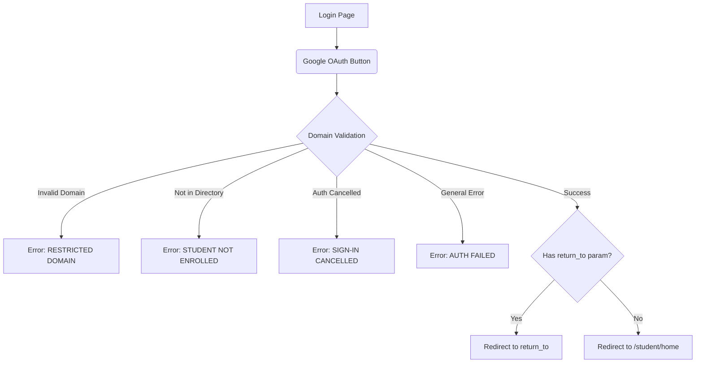
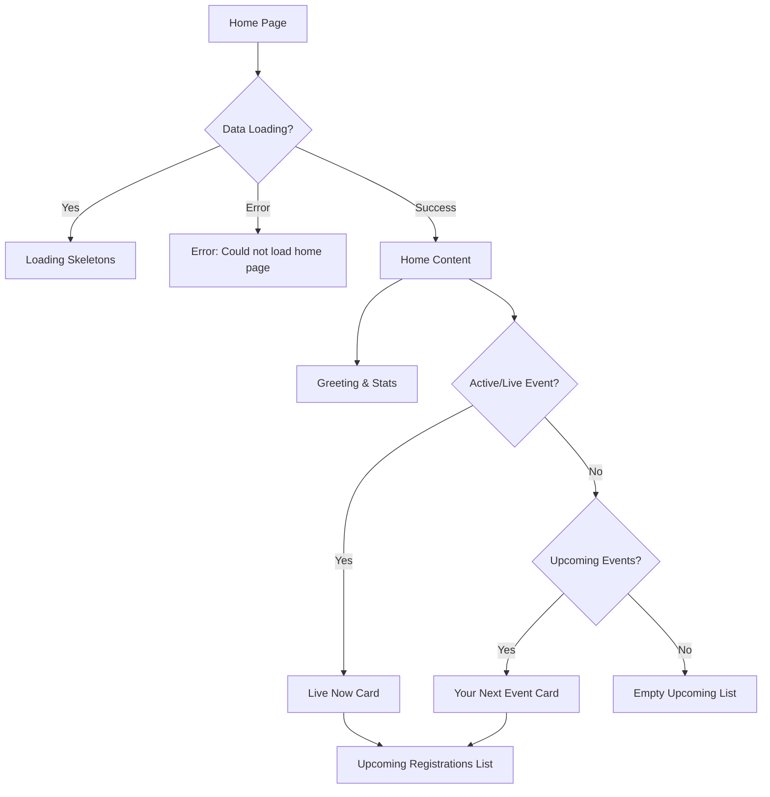
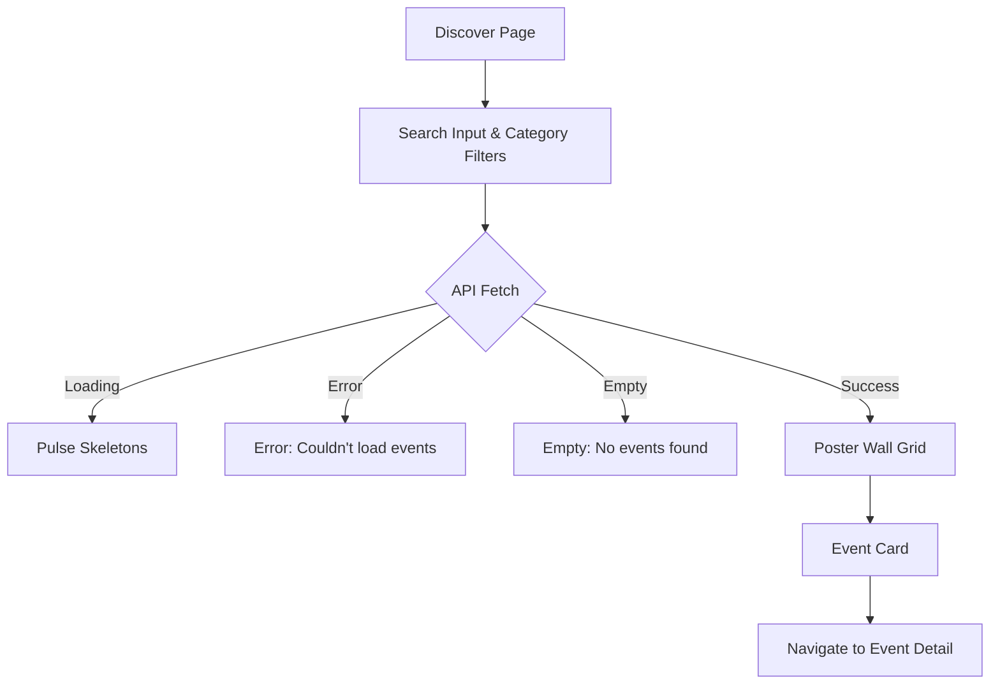
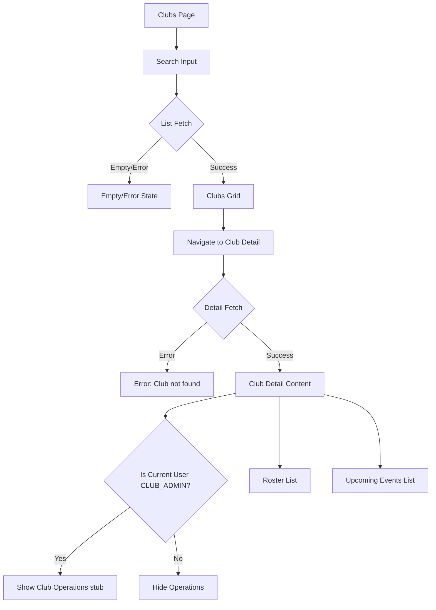
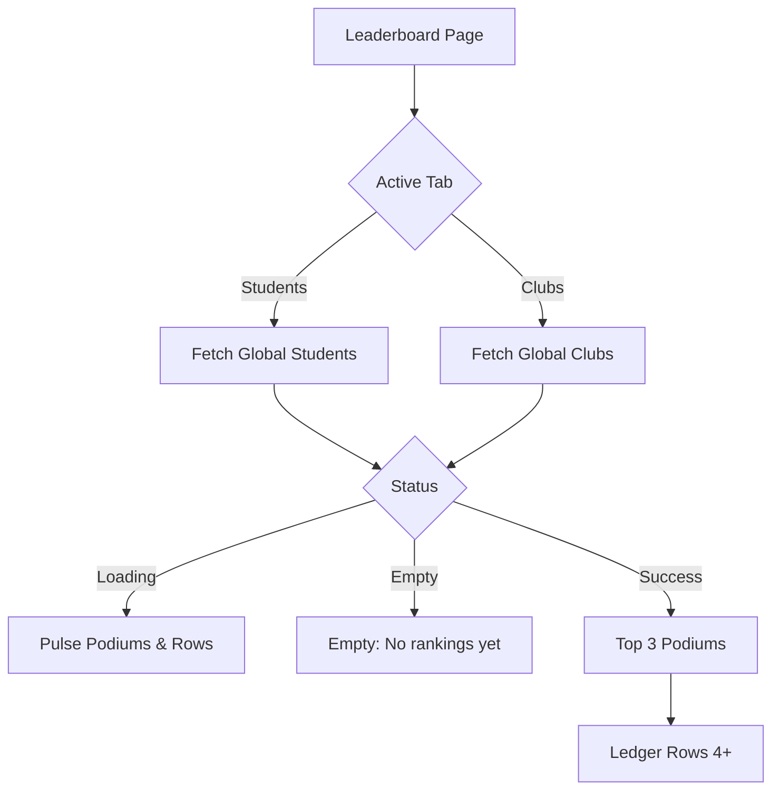
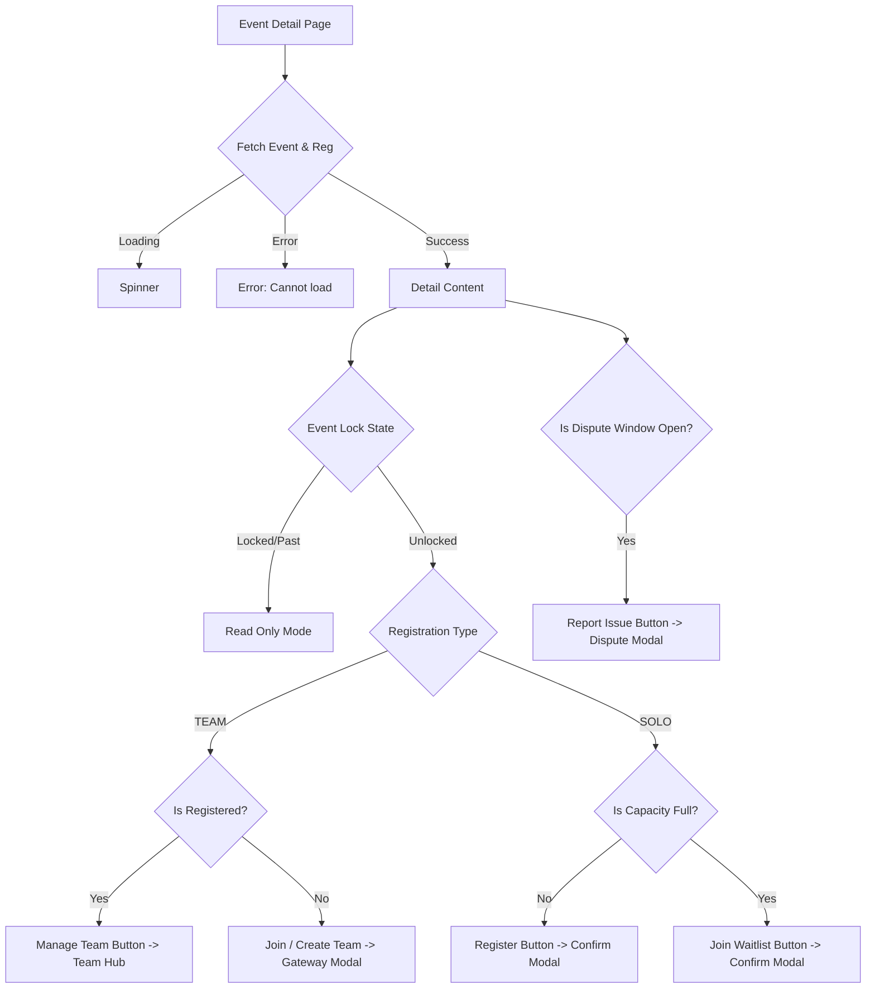
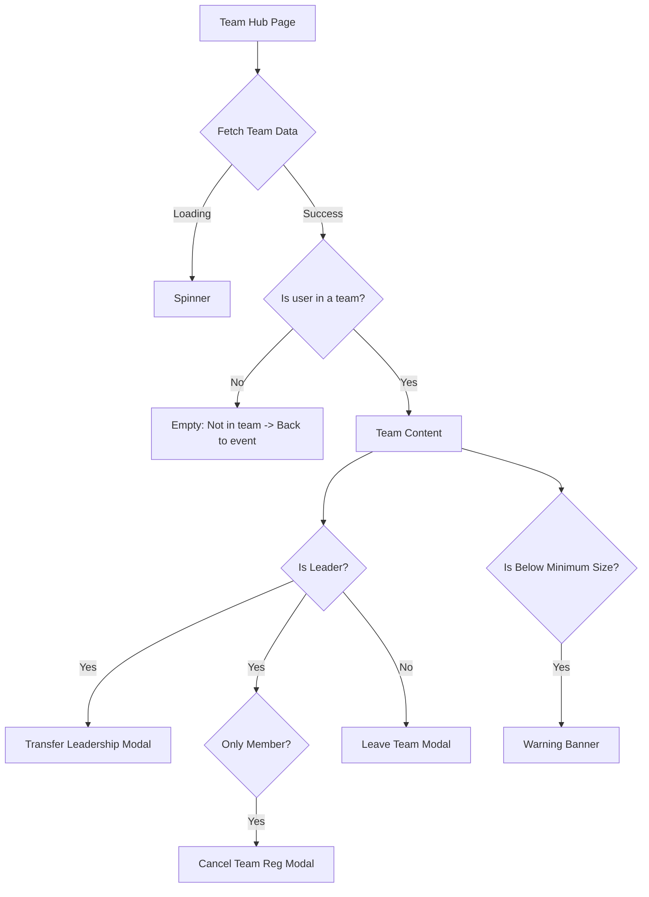
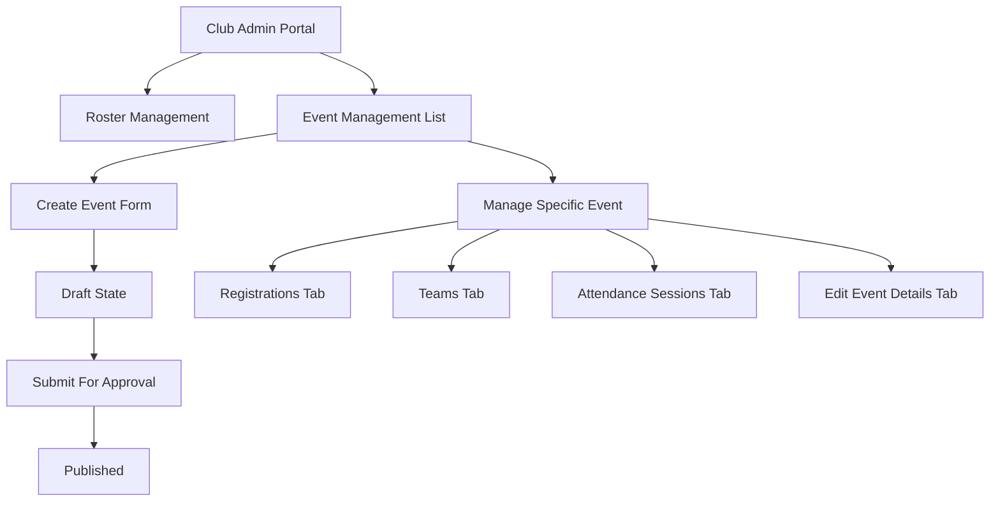
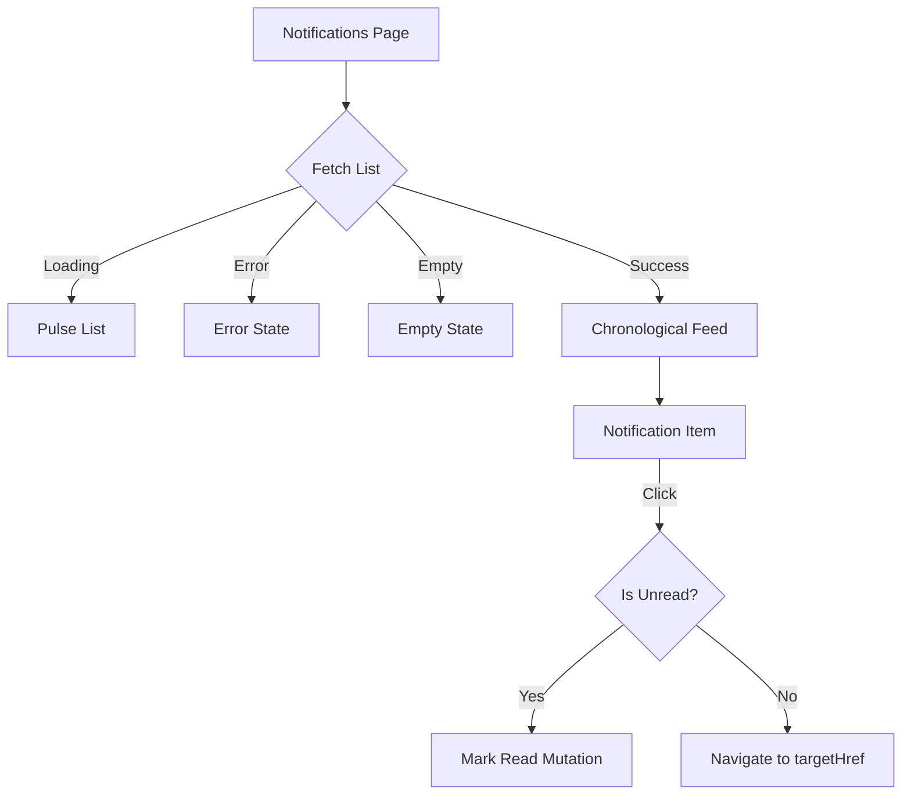
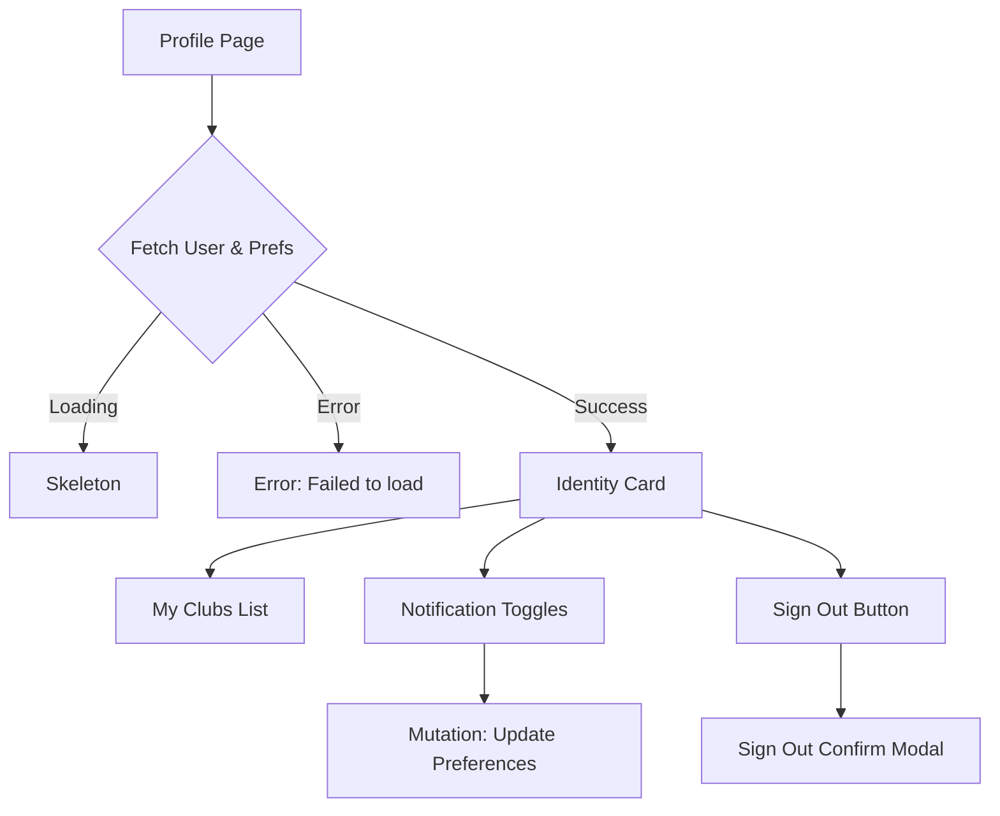

# NST Events — Student App UX Flowchart (Current State)

This document maps the **existing, in-code UX flows** for the student-facing web application (`apps/dashboard/app/(student)`). It serves as a faithful snapshot of the currently implemented UI states, conditional branches, and missing/stubbed functionality prior to the redesign.

---

## 1. Auth & Entry

- **UI States:**
  - **Idle:** Brand header, domain requirements text, Google login button.
  - **Error:** Neo-brutalist error enclosure with specific badge, message, and action buttons.
- **Conditional Branches:**
  - `INSTITUTIONAL_DOMAIN_NOT_ALLOWED`: Shows "Switch Account" action.
  - `STUDENT_ACCESS_NOT_AUTHORIZED`: Shows "Contact Coordinator" email trigger.
  - `ACCESS_DENIED` & `AUTHENTICATION_FAILED`: Shows "Switch Account".

---

## 2. Home Dashboard

- **UI States:**
  - **Loading:** Pulse skeletons for stats and cards.
  - **Error:** "Could not load your home page" + Retry button.
  - **Content:** Dynamic greeting based on time of day.
- **Conditional Branches:**
  - **Live Now Card:** Shows if a registered event's start time is within 15 minutes of the current time. Links to Event Detail.
  - **Your Next Event:** Shows the immediate next upcoming event (excluding the live one).
  - **Upcoming List:** Shows the rest of the future registered events.

---

## 3. Campus: Discover Feed

- **UI States:**
  - **Loading:** Grid of pulse skeletons.
  - **Error:** "Something went wrong" + Retry button.
  - **Empty:** "Try a different search" + Clear Filters button.
- **Conditional Branches:**
  - Search input (`q`) is debounced and updates the URL.
  - Category pill clicks update the `type` URL param.
  - API fetches `PUBLISHED` events matching the filters.

---

## 4. Campus: Clubs Directory

- **UI States (List & Detail):**
  - **Loading:** Skeletons for the grid or the club banner.
  - **Error/Not Found:** "Club not found" + "Back to Directory" button.
- **Conditional Branches:**
  - **Role check:** If user has `CLUB_ADMIN` role for this specific club, a "Club Operations" panel is rendered.
- **Stubbed/Unfinished:**
  - **[NOT YET BUILT]** "Club Operations" panel is currently a placeholder stating: *Administrative controls are currently being integrated. Event creation and roster management will appear here.*

---

## 5. Campus: Leaderboard

- **UI States:**
  - **Loading:** Pulse animation for top 3 podiums and list rows.
  - **Empty:** "Check back later when activity begins".
- **Conditional Branches:**
  - **Tabs:** State toggles between `students` and `clubs` queries.

---

## 6. Event Detail & Registration

- **UI States:**
  - **Loading:** Spinner with "Loading Event...".
  - **Error:** "This event could not be loaded."
  - **Read Only:** "Event Locked — Read Only" banner.
- **Conditional Branches:**
  - **Lock State:** True if `lock_state !== 'UNLOCKED'`, or 24 hours past `endTime`, or `endTime` has passed. Disables registration actions.
  - **Dispute Window:** Open for 24 hours after the event ends. Allows filing attendance disputes.
  - **Capacity:** If registrations >= maxCapacity, switches SOLO flow to Waitlist.
  - **Admin View:** If user is a `CLUB_ADMIN` for the organizing club, shows a hidden link to the organizer manage page.

---

## 7. Team Hub

- **UI States:**
  - **Loading:** Spinner.
  - **Warning:** `isBelowMinimum` triggers a warning state indicating the team is invalid.
- **Conditional Branches:**
  - **Leadership restrictions:** Leaders cannot leave the team unless they are the *only* member (which cancels the team entirely) or they transfer leadership first.

---

## 8. Organizer/Manage Flows

- **UI States & Conditional Branches:**
  - Depends on `role === 'CLUB_ADMIN'` for the active club context.
  - **Event Lifecycle:** Draft -> Submitted -> Published/Rejected.
  - **Teams Management:** Admins can manually promote waitlisted teams, cancel teams, or forcibly transfer leadership.

---

## 9. Notifications Flow

- **UI States:**
  - **Loading:** Pulse animation list.
  - **Empty:** "No notifications."
- **Conditional Branches:**
  - `readAt` timestamp presence determines visual unread indicator.
  - Clicking an item triggers navigation and background read mutation simultaneously.

---

## 10. Profile

- **UI States:**
  - **Loading:** Skeleton structure.
  - **Error:** "Failed to load profile" + Retry.
- **Conditional Branches:**
  - **Academic Profile:** Fallbacks for displaying Batch, Program, or generic Student.
  - **Clubs Empty State:** If `club_memberships` is empty, shows CTA to Discover Clubs.
  - **Toggles:** Immediate optimistic UI mutation for push, reminders, announcements, and alerts.
